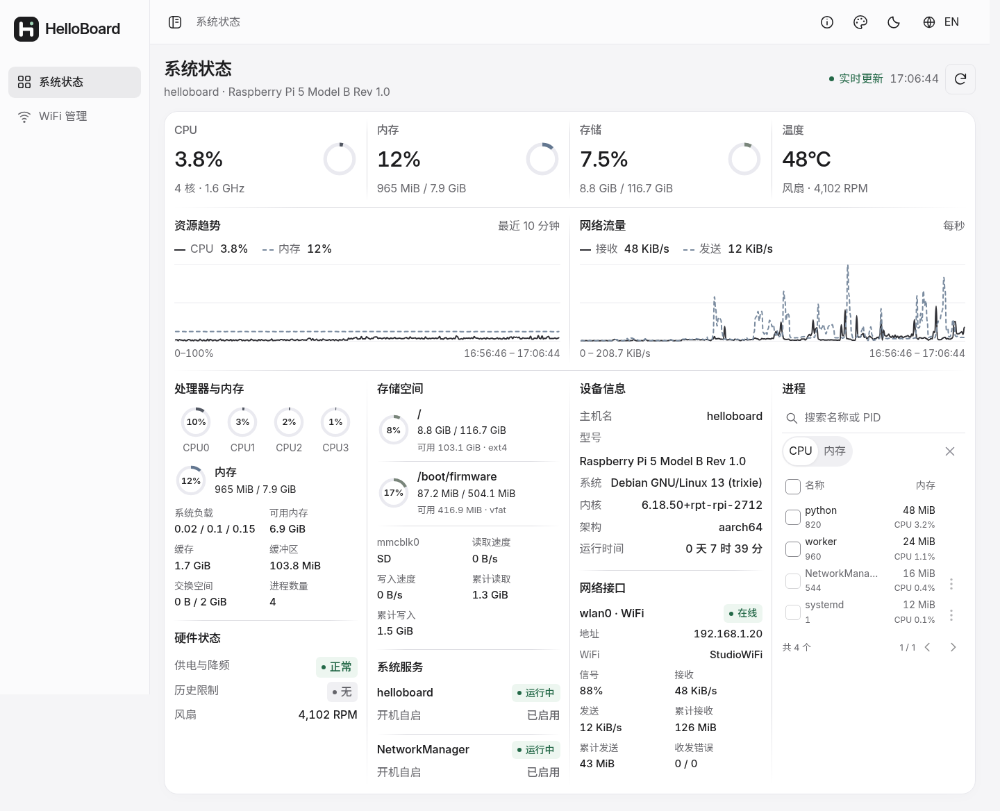

<h1 align="center">HelloBoard</h1>

<p align="center">A lightweight system dashboard for Linux devices.</p>

Monitor system resources, manage processes, and configure WiFi from a desktop or phone. Built with Flask, Waitress, and plain HTML, CSS, and JavaScript. No Node.js, database, or external CDN required.



## Features

- CPU, memory, storage, network traffic, and hardware metrics where available.
- Live charts with shared, in-memory history across page reloads.
- Process search, sorting, and bulk termination with system-account verification.
- WiFi scanning, saved networks, and AP mode on supported Linux systems.
- Light and dark themes, English and Chinese, and compact or spacious layouts.
- Responsive navigation, subtle dividers, local fonts, and SVG icons.

## Quick start

Requires Python 3.10+.

```bash
git clone https://github.com/GCUSMS-AI-ProJect/helloboard.git
cd helloboard
python3 -m venv .venv
.venv/bin/python -m pip install -r requirements.txt
.venv/bin/python wifi.py --dashboard-only
```

Open **http://localhost:8090**. Dashboard mode does not change your network configuration.

For a Linux system service on port 80:

```bash
sudo bash install.sh
sudo systemctl enable --now helloboard
```

WiFi management requires NetworkManager, root privileges, and a compatible wireless adapter. AP mode also requires hotspot support. Use `install.sh --with-wifi` only when you intend to apply the saved network configuration.

Optional local discovery on Debian / Ubuntu:

```bash
sudo apt install avahi-daemon
sudo python3 tools/enable_local_name.py
```

Then open **http://helloboard.local** from the same local network using an mDNS-capable client.

## Lightweight by design

A single server process shares background sampling across browsers. Static assets use compression and versioned caching; the UI reuses existing elements and stops polling in hidden tabs.

Recorded Linux benchmarks showed approximately **36.5 MiB RSS at startup**, **39.6 MiB after load**, and **52% less initial static-asset transfer** after optimization. Results vary by device and workload; see the [benchmark methodology](docs/performance.md) (Chinese).

## Platform support

Linux is the primary platform, including Raspberry Pi and Ubuntu / Debian devices. Available features depend on hardware and system capabilities. Windows monitoring is implemented but has not been verified on a physical Windows host; WiFi management and process termination are not supported there.

Designed for trusted local networks. Sensitive actions require system-account verification. WiFi credentials remain in the local configuration; do not expose the dashboard directly to the public internet.

## Documentation

- [UI design prompt](PROMPT.md) (Chinese)
- [Project guide and installation](docs/project-guide.md) (Chinese)
- [Deployment and local discovery](docs/operations.md) (Chinese)
- [Performance measurements](docs/performance.md) (Chinese)
- [Offline Ubuntu amd64 package](docs/deb.md) (Chinese)
- [Font sources and licenses](static/fonts/SOURCES.md)
