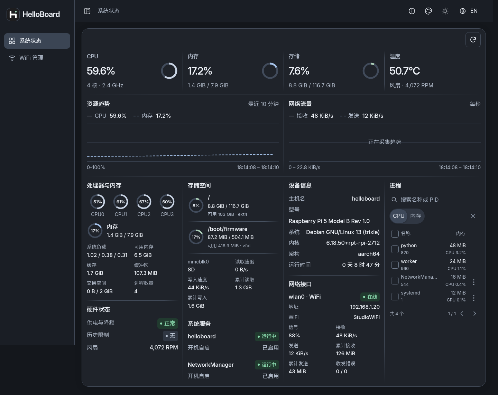
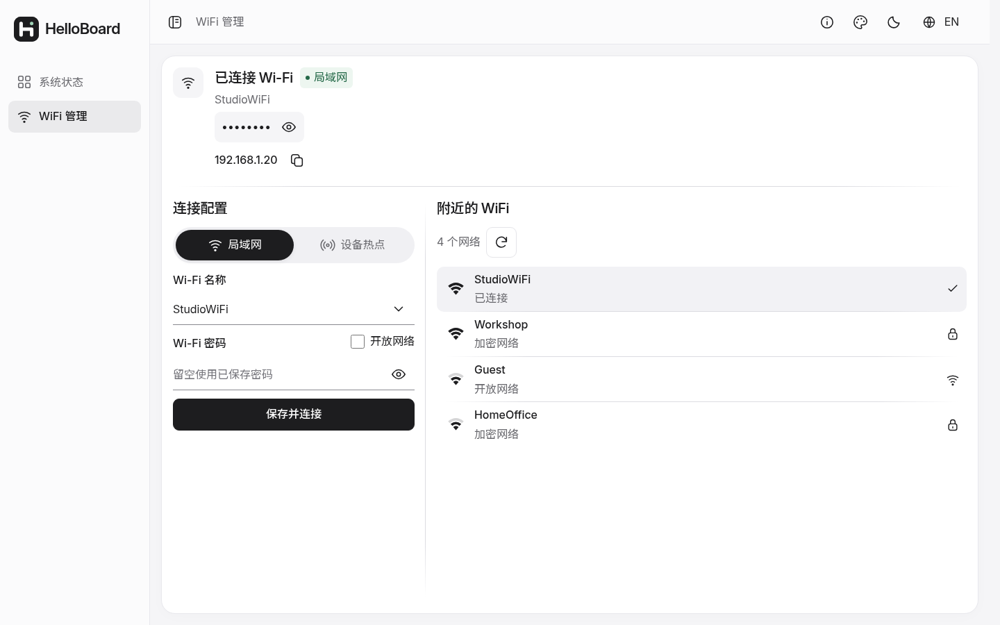
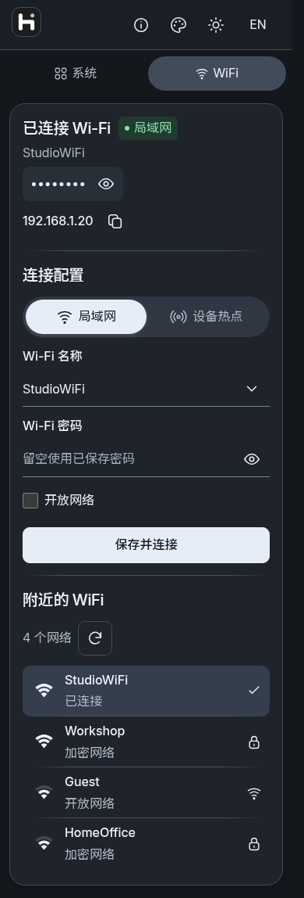

<h1 align="center">HelloBoard</h1>

<p align="center">界面设计提示词 · 布局 · 字体 · 配色 · 组件 · 交互</p>

这份提示词用于延续 HelloBoard 的界面风格，也可作为其他系统看板的设计要求。复制下方整段内容交给设计或开发工具，替换项目名称与业务模块即可使用。

## 可直接复制的设计提示词

```text
请为 HelloBoard 设计并实现一个轻量、柔和、清晰、具有辨识度的系统数据看板。
以苹果软件的排版秩序和克制交互为参考，结合现代技术工具的精确感。
整体统一，信息紧凑但不拥挤；保留现有业务功能、操作权限与响应效率。
新增页面和组件必须沿用以下规则。

一、整体布局
- 桌面使用左侧固定导航和右侧内容区，充分利用可用宽度；不把内容挤在页面中央的小区域。
- 导航展开宽度参考 216px；收起后只保留图标，悬停显示名称提示。
- 收起/展开使用独立 SVG 按钮，与“WiFi 管理”等文字入口分开；切换平滑，不干扰操作。
- 每个功能使用独立子页面，支持直接访问和浏览器前进/后退；系统状态为 /system_status，WiFi 管理为 /wifi_config。
- 右上角统一放置主题、中英文、样式设置与帮助入口，顺序和占位保持稳定。
- 不重复显示“系统状态”“网络设置”等大标题，不在左下角追加重复产品介绍。
- 手机改为适合触控的顶部导航与单列内容，不机械缩小桌面页面，不出现整页横向滚动。
- 桌面紧凑模式尽量让核心信息同屏；小屏、放大字体和宽松模式允许自然纵向滚动，不能为了塞满一屏裁切内容。

二、紧凑与宽松布局
- 提供两种明显不同的布局，通过右侧滑出的样式设置面板选择。
- 紧凑模式：系统指标与详情区在宽屏主要采用四栏，趋势区双栏，内容间距参考 14–16px。
- 宽松模式：系统指标与详情区主要采用两栏，内容间距参考 28–32px，图表更高，行间距和留白明显增加。
- 根据模块数量和设备能力调整列数；平板逐步减列，手机自然单栏，不保留空白占位卡。
- 两种模式可以重新组织排布，不能只调整几像素内边距；切换时保留输入、选择和当前功能状态。
- 布局过渡柔和，避免闪白、突然位移及连续触发布局计算。

三、字体与排版
- 英文及数字使用本地 Inter，中文使用本地 Noto Sans SC，中英文字重和基线协调。
- 字体随项目提供，不能依赖苹果系统字体或外部字体 CDN；常用字库优先，完整回退字库按需加载。
- 建议正文 16px、行高约 1.6；模块标题 16–20px、字重 500–600；关键数值 30–36px。
- 数字使用等宽数字特性，避免刷新时宽度跳动；标题、正文和辅助文字层级清晰。
- 不堆叠小字和说明，不用过细、难辨认的箭头；长名称、IP、英文和 PID 都需合理换行或截断。

四、配色与深浅主题
- 浅色：背景 #f5f5f7，主面板 #ffffff，主要文字 #1d1d1f，辅助文字 #68686d。
- 深色：背景 #14171c，主面板 #1f232a，浮层 #292e37，主要文字 #edf1f7，辅助文字 #b0bac9。
- 使用统一语义色变量管理背景、边框、文字、悬停、禁用、图表和遮罩，不在各组件随意拼接颜色。
- 浅色主要操作以黑底白字呈现；深色使用清晰的浅色按钮和深色文字，保证按钮、表单与面板可辨识。
- 绿色表示在线/正常，橙色表示需要关注或过渡状态，灰色表示离线/不可用，红色用于错误或危险操作。
- 状态必须同时有文字或图标，不能只靠颜色；“开机自启”“已启用”等属性使用中性灰，不与运行状态抢层级。
- 悬停高亮轻微，深色模式不能直接反色；检查正文、提示、占位符、选中和禁用状态的对比度。

五、面板、卡片与分隔线
- 每个页面尽量使用一块连续主面板，内部按区域分组，不把每项数据单独包成卡片，不层层套卡片。
- 外层面板保留柔和圆角、轻阴影；内部区域背景透明，减少重复边框、圆角和投影。
- 区域之间使用 1px 灰色渐变分隔线，两端逐渐淡出；横向和纵向分隔统一风格。
- 横线可参考 linear-gradient(90deg, transparent, var(--line-color) 16%, var(--line-color) 84%, transparent)。
- 圆角保持统一：对话框约 18px，侧滑面板靠内容一侧约 20px；胶囊按钮使用完整圆角。
- 阴影柔和且低对比，不做厚重悬浮、霓虹描边或大面积高成本模糊。

六、按钮与 SVG 图标
- 简单操作优先使用单个 SVG 图标按钮，如刷新、复制、查看密码、样式设置和终止进程。
- 不用 emoji 代替图标，不给同一个操作套两层边框，也不给普通提交按钮强行添加打勾装饰。
- SVG 参考 20–22px、描边约 1.7px，圆头圆角，统一视觉重量；复杂品牌图标可以单独定制。
- 图标必须完整可见，不能被容器、圆角或 overflow 裁掉；复选框勾选图形使用清晰 SVG，避免锯齿。
- 按钮紧凑排列，但点击目标建议至少 44×44px，不能缩小到手机难以点击。
- 网络模式切换使用黑白胶囊分段按钮，选中指示块平滑滑动；点击不缩放、不抖动，悬停不过度变亮。
- 语言、主题及图标按钮使用稳定占位；切换中文/英文或加载状态时，不推动旁边按钮。
- 图标按钮提供准确的 aria-label 和悬停提示；手机不能依赖悬停才能发现操作。
- 所有操作具备默认、悬停、聚焦、按下、加载与禁用反馈；禁用时仍清晰可读。

七、表单、下拉与密码
- 编辑栏采用标签加底部横线，避免每个输入框都用圆角方框包围；聚焦时轻微强调横线。
- 保留明确标签，不只用占位符说明用途；错误就近显示，不能让工具栏或整块布局突然跳动。
- 已连接网络的名称和保存信息可以自动填入选择栏；扫描与连接过程中保留用户已输入内容。
- 下拉菜单、保存网络列表和自定义选择器沿用主题、字体、间距、圆角与阴影，不能出现突兀的默认样式。
- 密码默认隐藏，提供 SVG 查看/隐藏按钮；密码值不能作为普通提示文字显示。
- 需要验证时，标题简写为“验证登录”；账号密码和错误信息放在同一紧凑对话框内。
- 保留各功能现有鉴权规则；外观调整不能取消敏感操作的验证与确认。

八、弹窗、侧滑与提示
- 帮助、样式和较长说明由右侧滑入面板承载，主界面只保留必要入口和短标签。
- 侧滑面板参考宽度 440px，窄屏限制在可用屏宽内；内部可独立滚动，关闭按钮保持可达。
- 侧滑进入约 420ms、退出约 260ms；进入可用 cubic-bezier(0.22, 1, 0.36, 1)，退出更短但仍柔和。
- 普通对话框进入约 280ms、退出约 220ms，采用轻位移加淡入淡出，避免夸张弹跳。
- 复制成功等短提示显示在页面中央，约 120ms 淡入淡出，不放在底部，不反复堆叠遮挡操作。
- 弹窗支持键盘操作、Escape 关闭和合理焦点管理；关闭后将焦点还给触发按钮。
- 遵循 prefers-reduced-motion，减少动态效果时取消非必要位移和动画。

九、WiFi 管理页面
- 将已连接信息、连接配置、附近 WiFi 组织为一块连续面板；桌面尽量横向排布，手机按操作顺序纵向展示。
- 已连接信息依次显示 WiFi 名称、密码区域、IP 地址；IP 不必再加重复的“IP 地址”解释。
- 查看密码按钮靠近对应信息，复制 IP 提供居中短提示，不暴露密码到提示中。
- 区域标题使用“附近的 WiFi”；数量右侧放刷新 SVG 按钮，不放在标题左侧。
- 信号强弱使用类似手机的 WiFi 图标，以填充弧线表达强弱，不能只显示数字。
- “局域网连接 / 设备热点连接”使用胶囊切换；热点密码支持查看/隐藏。
- AP 密码设置保留在设备热点的相关区域，避免导航和右上角重复放置同一入口。
- 帮助内容放入右上角入口后的侧滑面板，不在首页长篇解释网络切换。

十、系统状态与进程区域
- CPU、内存、存储使用紧凑环形图配合数值，各核心指标合理排列，不能挤坏页面或靠放大图表占空间。
- 趋势曲线连续、柔和过渡，刷新数据时不清空重画；有采样间隔但视觉上保持连贯。
- 保留后台共享的历史，刷新页面后恢复已有曲线；不要伪造未采样数据或用装饰性随机曲线替代。
- 刷新按钮放在主面板内部，点击立即请求一次；不增加“暂停更新”按钮或常驻更新时间大块。
- 进程区域与其他详情协调，提供名称/PID 搜索、排序和多选；PID 直接显示数字，不额外加 #。
- 行操作可在鼠标悬停或键盘聚焦时轻微上移淡入；触屏需有可发现的操作入口。
- 不可终止的关键进程及其选择控件使用灰色，可选进程使用正常文字色；不能仅视觉禁用而保留操作能力。
- 终止所选使用单个 SVG 操作入口，按现有规则弹窗验证并确认，保留明确的加载和结果反馈。

十一、语言、主题与状态保持
- 默认中文，提供中英文切换；主题、语言、布局密度和侧栏状态在页面之间保持一致。
- 偏好保存于浏览器本地，刷新、跨子页面、重启服务后仍继续使用；不同浏览器之间无需自动同步。
- 切换语言、主题或布局不清空表单、不丢失进程选择，不额外触发 WiFi 扫描或连接。
- 无数据时显示清晰空态或横线；不把缺失指标当成 0，也不展示不可用的空白模块。

十二、性能与验收
- 优先原生 HTML/CSS/JavaScript、CSS 变量和可复用 SVG；不为少量动效引入大型框架或额外运行时。
- 字体、图标和脚本本地提供；常用资源按内容版本缓存，扩展字库按需加载。
- 共享后台采样，更新时复用已有 DOM，仅修改变化内容；后台标签页减少无意义轮询。
- 动画优先 opacity 和 transform，避免反复测量布局、持续运行的空闲动画或整页重建。
- 长列表采用分页或受控滚动；不为了减少页面滚动而隐藏数据和操作。
- 检查 360/390px 手机、平板、常见 PC 宽度，以及浏览器放大和长中文/英文内容。
- 验收深浅色、两种布局、中英文、键盘焦点、手机触控、加载/错误/禁用、弹窗进入/退出，以及表单和选择状态保持。
- 界面改造不能降低现有操作响应、数据刷新效率或显示效果；需要用实际检查结果说明完成情况。
```

## 界面参考




<table>
  <tr>
    <td width="74%"></td>
    <td width="26%"></td>
  </tr>
</table>

## 项目文档

- [项目介绍、性能数据与源码安装](docs/project-guide.md)
- [Ubuntu amd64 离线 deb 安装](docs/deb.md)
- [部署与配置](docs/operations.md)
- [性能验证与优化方法](docs/performance.md)
- [字体来源与许可证](static/fonts/SOURCES.md)
- [HelloBoard v0.1.0 发行版](https://gitee.com/gcusms/helloboard/releases/tag/v0.1.0)
